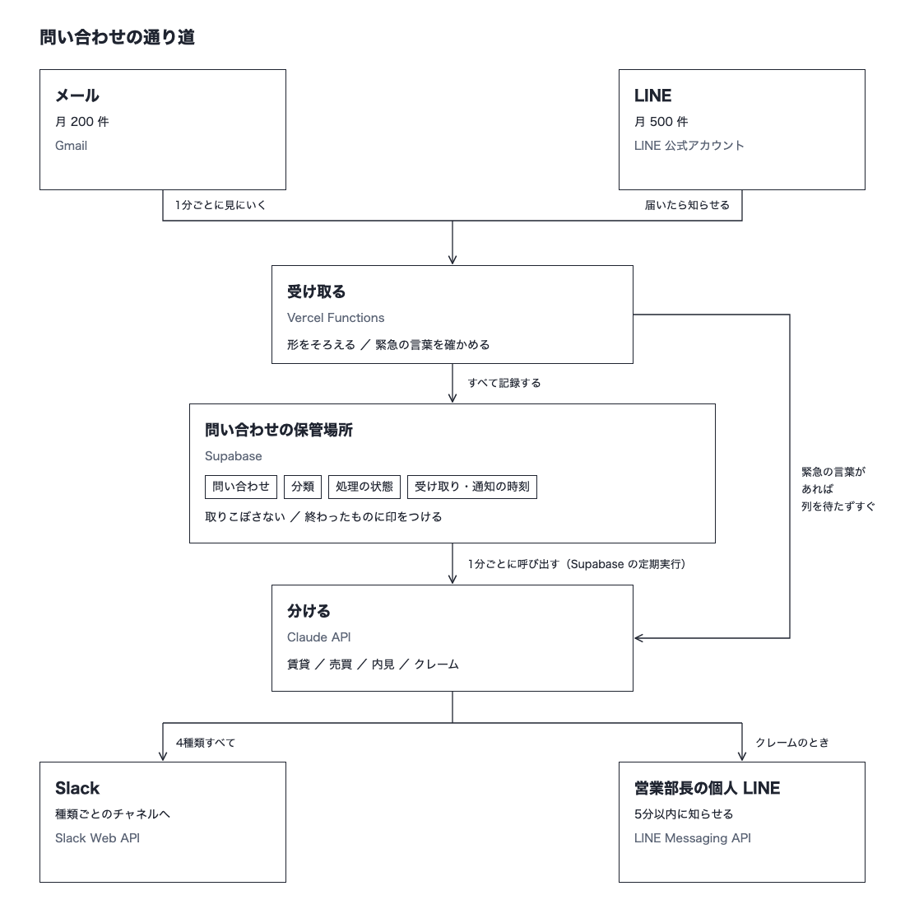

# 問い合わせ集約と自動振り分け（マルチチャネル通知 + AI自動分類）

不動産管理会社向けの練習案件です。
メールと LINE に届いた問い合わせを1か所に記録し、AI（Claude）が「賃貸・売買・内見・クレーム・その他」に分けて Slack に知らせます。
クレームは、営業部長の個人 LINE にも5分以内に届けます。

- 本番：https://multichannel-notify-ai.vercel.app （画面はなく、受け取り口だけ）
- 構成図：[アーキテクチャ.png](アーキテクチャ.png)



## しくみ

| 道 | 流れ | 届くまで |
|---|---|---|
| ふつうの道 | LINE は届いたら記録、メールは1分ごとに見にいって記録 → 1分ごとに AI で分ける → Slack | 1〜2分 |
| 急ぎの道 | 「クレーム・至急・苦情・怒り・緊急」を含むものは、列を待たずにすぐ AI で判断 → Slack と部長の LINE | 数秒 |

- 同じメッセージは2回記録しません（メッセージ番号に重ならない印を付けています）。
- 途中で失敗したら、1分ごとの道が最大3回までやり直します。済んだところ（分類・Slack・LINE）は繰り返しません。
- 電話は対象外です。

| 使ったもの | 役わり |
|---|---|
| Next.js（Vercel・東京） | LINE の受け取り口、1分ごとの処理の呼び出し口 |
| Supabase（Postgres） | 問い合わせの記録（`case5` スキーマ）、1分ごとの呼び出し（pg_cron + pg_net） |
| Claude API（`claude-opus-5-5`） | 種類分けと、その理由の短いメモ |
| Gmail API | 窓口メールの読み取り（読むだけの許可） |
| LINE Messaging API | 受け取り（Webhook・署名を確認）と、部長への通知 |
| Slack API | 種類ごとの部屋への通知 |

## 運用マニュアル（短い版）

クライアントには、図入りの PDF を別に渡しています。文章は [運用マニュアル.md](運用マニュアル.md)、PDF は `python3 scripts/build-manual.py` で作ります。ここでは要点だけ書きます。

- **毎日見るところ**：Slack の `#問い合わせ-賃貸` `#問い合わせ-売買` `#問い合わせ-内見` `#問い合わせ-クレーム` `#問い合わせ-その他`。クレームは部長の LINE にも「🚨 クレームの問い合わせです」で届きます。
- **通知の中身**：種類と入り口、お客さまの文、AI の判断（理由）、受付の時刻。
- **返信**：今までどおり、メールや公式 LINE の管理画面から送ります。Slack からは返信できません。
- **触らないところ**：Slack の5つの部屋を消さない・アーカイブしない。公式 LINE の Webhook 設定を変えない。窓口メールのパスワードを変えたら開発担当に知らせる（Gmail の許可を取り直す）。
- **頼まれたら開発担当がすること**：急ぎの言葉を増やす、部長以外にも LINE で届ける。

## 動いているかの確認（監視）

Supabase の SQL Editor に [supabase/monitor.sql](supabase/monitor.sql) の「1」を貼って Run します。
ここ24時間の「止まっている」「失敗」「クレーム5分超え」がすべて 0 なら問題ありません。1 以上なら「2」を流して、どの問い合わせかを確かめます。

## API キーの取り替え

[docs/APIキーの取り替え手順.md](docs/APIキーの取り替え手順.md) にまとめています。

## 環境変数

`.env.local`（手元）と Vercel の Production に置きます。値は Git に入れません。

| 名前 | 中身 |
|---|---|
| `DATABASE_URL` | Supabase の接続先（Transaction pooler・6543番） |
| `ANTHROPIC_API_KEY` | Claude API の鍵 |
| `LINE_CHANNEL_SECRET` | LINE の署名を確かめる合言葉 |
| `LINE_CHANNEL_ACCESS_TOKEN` | LINE で送るための鍵 |
| `LINE_MANAGER_USER_ID` | 部長の LINE のユーザーID（クレームの届け先） |
| `SLACK_BOT_TOKEN` | Slack で送るための鍵（`chat:write`） |
| `SLACK_CHANNEL_RENT` / `_SALE` / `_VIEWING` / `_CLAIM` / `_OTHER` | 種類ごとの部屋の ID |
| `GMAIL_CLIENT_ID` / `GMAIL_CLIENT_SECRET` | Google の OAuth クライアント |
| `GMAIL_REFRESH_TOKEN` | 窓口メールを読む許可（`gmail.readonly`）。`scripts/gmail-auth.py` で取る |
| `CRON_SECRET` | 1分ごとの呼び出し口の合言葉。Supabase の Vault（`case5_cron_secret`）にも同じ値を置く |

## はじめて動かすとき

1. `npm install`
2. Supabase の SQL Editor で [supabase/schema.sql](supabase/schema.sql) を流す
3. `.env.local` に上の環境変数を入れる。Gmail は `python3 scripts/gmail-auth.py <credentials.json> <窓口のメール>`
4. `npm run dev`。LINE を手元で試すときは、トンネル（cloudflared など）で外から届く住所を作り、LINE Developers の Webhook URL に `https://<住所>/api/webhooks/line` を入れる
5. 本番は `vercel --prod`。そのあと Supabase の Vault に `case5_cron_secret` を入れて、[supabase/cron.sql](supabase/cron.sql) を流す（1分ごとの呼び出しが始まる）

1分ごとの呼び出しを止めるとき：`select cron.unschedule('case5-classify');`

## 分け方の試験

[case5-test-inquiries.csv](case5-test-inquiries.csv) の22件で、AI の分け方を確かめます（22件中22件が正解）。

```bash
node --env-file=.env.local scripts/try-classify.mjs        # 全件
node --env-file=.env.local scripts/try-classify.mjs 3 21   # 番号を選んで
bash scripts/check-classify.sh                             # Claude Code に採点させる
```

## ファイル

```
src/app/api/webhooks/line/route.ts  LINE の受け取り口（署名の確認 → 記録 → 急ぎならすぐ処理）
src/app/api/cron/classify/route.ts  1分ごとの呼び出し口（メールを見る → 未処理を分けて知らせる）
src/lib/process.ts                  受け取り・分類・通知の流れ（やり直しと重複防止）
src/lib/classify.ts                 Claude で種類分け
src/lib/gmail.ts / line.ts / slack.ts / db.ts
supabase/schema.sql / cron.sql / monitor.sql
```
